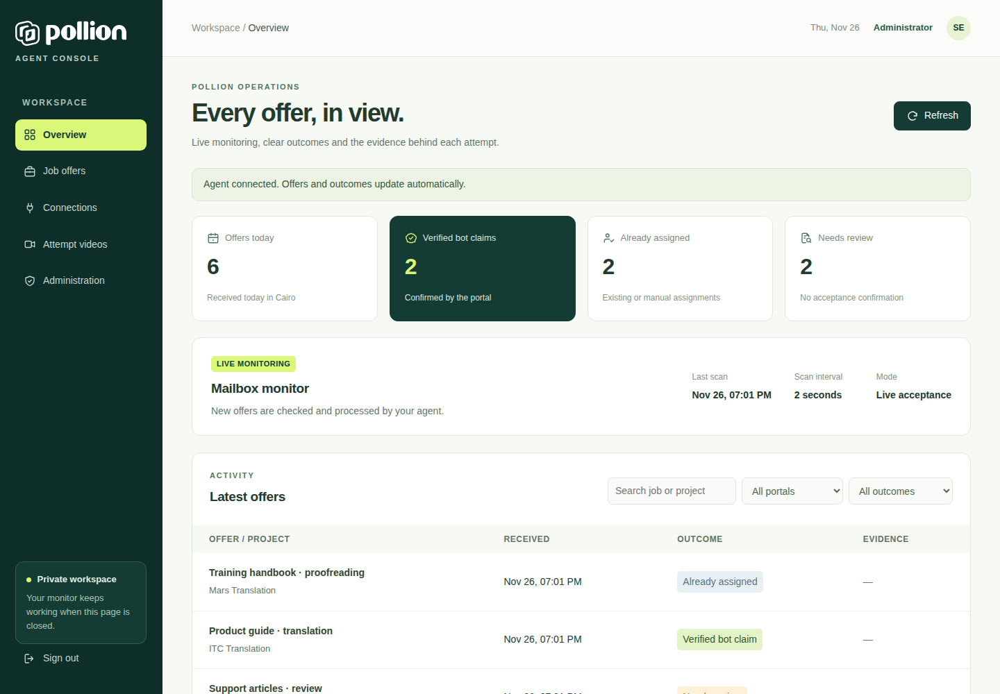
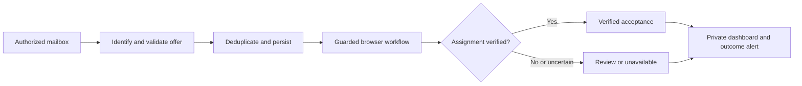

# Pollion Job Claimer

**A private operations agent for translation offers — built and owned by Seif Elden Magdy.**

Pollion connects an authorized mailbox to guarded portal workflows, attempts to accept available translation offers, checks the resulting assignment, and reports the outcome in a private dashboard.

This repository is a **public project overview**. The implementation is maintained in a separate private repository. No runnable agent code, client data, credentials, portal sessions or production recordings are published here.

## Agent Console · version 12

The overview shows how many offers arrived today and whether the agent verified a claim, found an existing assignment or flagged an offer for review. Each of the four cards has its own icon on desktop and mobile. Operators can open individual offers and review attempt recordings.

*All offers in this image are synthetic. It demonstrates the interface, not live assignments or acceptance performance.*

## What it does

| Capability | Purpose |
| --- | --- |
| Mailbox monitoring | Identify supported offer links from authorized incoming mail. |
| Six portal workflows | Support Mars Translation, ITC Translation, LanguageWire, Translate 24/7, Propio and Translat d.o.o. |
| Guarded acceptance | Handle task agreements and confirmation dialogs while avoiding job-completion actions. |
| Outcome verification | Distinguish a verified bot claim from an existing assignment, registered interest or an uncertain result. |
| Persistent state | Track offers and attempts, avoid duplicates, and preserve outcomes across restarts. |
| Operator evidence | Show scan health, newest-first offers and private attempt recordings. |
| Outcome notifications | Notify configured recipients after the acceptance attempt, with duplicate protection. |

## How it works

The implementation uses **Node.js, Playwright, IMAP and a private web dashboard**, with separate mailbox, portal, state, recording and notification components. It runs on an owner-controlled server independently of an open laptop or dashboard tab.

## Validation and limits

The isolated release snapshot passed **73 unit/API checks and 103 browser checks** on **24 November 2026**. The runtime dependency audit reported **zero known vulnerabilities** at that time. These results describe the tested snapshot, not a live acceptance success rate.

Synthetic browser scenarios exercise agreement checkboxes, confirmation dialogs, login redirects, interrupted submissions, expired offers, duplicate delivery and ambiguous controls. Tests are isolated from production accounts and do not accept real jobs.

Portal layouts, authentication and offer availability can change. Simulations do not establish a live acceptance rate, guarantee that an offer will be won, or attribute an existing assignment to the bot. An unresolved result remains unverified until supported by evidence.

## Ownership and access

Copyright © 2026 **Seif Elden Magdy**. **All rights reserved.** This is a proprietary project and is not offered as open source or as a public service. Viewing this overview grants no license to use or redistribute the project's original implementation or assets. See [LICENSE](LICENSE).

Third-party products and portal names belong to their respective owners. Their mention does not imply affiliation or endorsement.

Project owner: [Seif Elden Magdy](https://github.com/SeifMagdy66).
